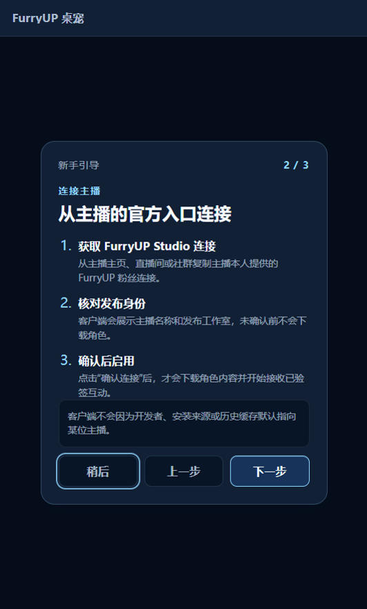
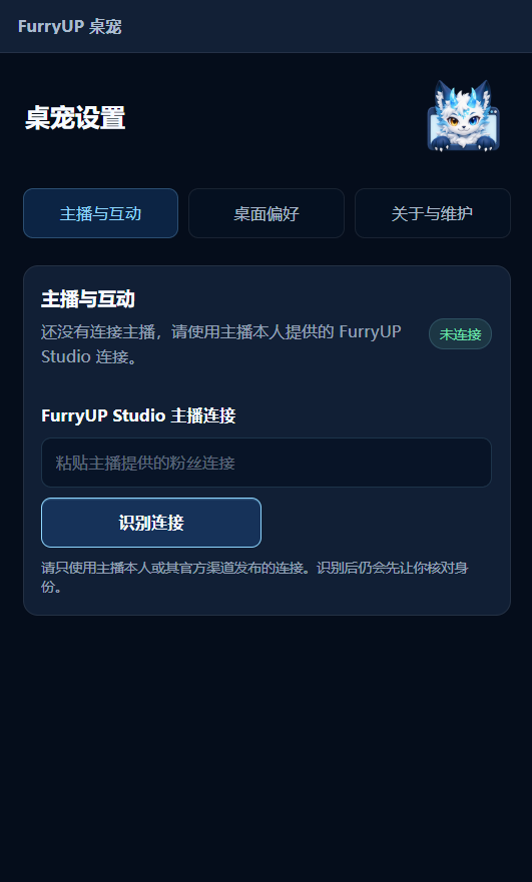
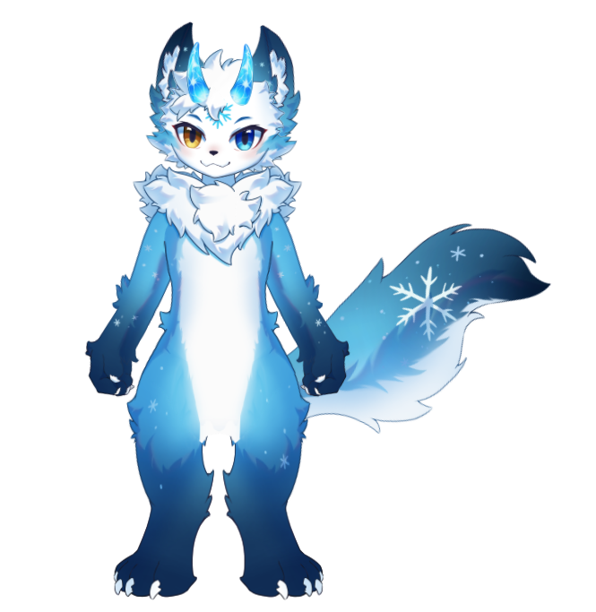
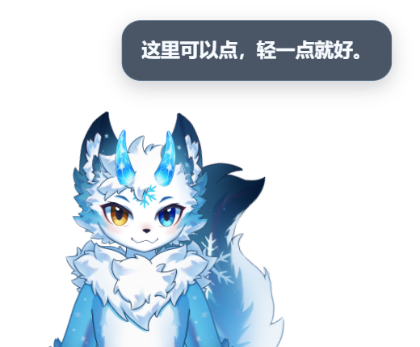
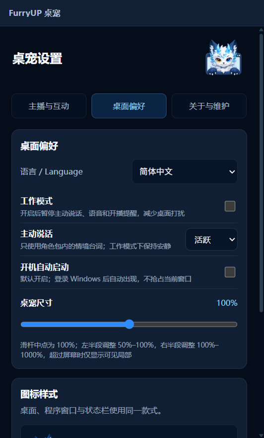
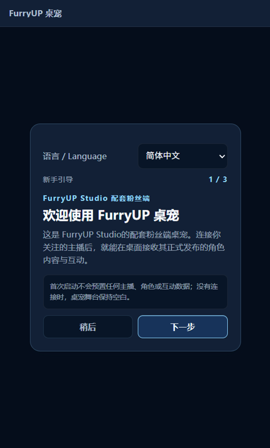
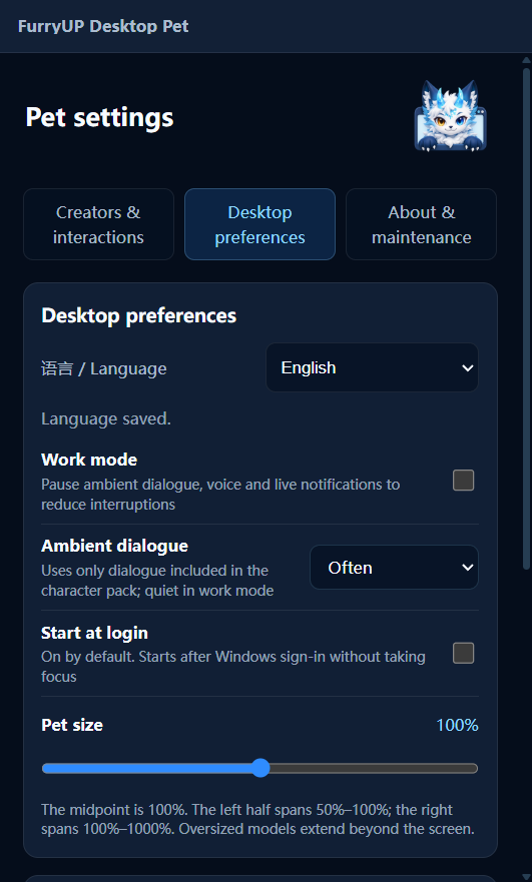

  

<h1 align="center">FurryUP 桌宠</h1>

<strong>把喜欢的主播角色带到自己的 Windows 桌面。</strong>

  <a href="#下载客户端">下载安装包</a> ·
  <a href="#第一次连接主播">首次连接</a> ·
  <a href="#产品展示">产品展示</a> ·
  <a href="#开发预览">0.4.0 预览</a> ·
  <a href="https://frostynight.top/furryup/desktop-pet">官方网站</a>

FurryUP 桌宠（FurryUP Desktop Pet）是 FurryUP Studio 的粉丝客户端。主播在 Studio 发布角色，把分享连接发给粉丝。你在桌宠里确认连接后，就能在桌面上看到这个角色，无需自己准备模型。主播可以发送表情、文字和开播提醒，你可以分别决定接收哪些互动。

## 下载客户端

当前公开测试版为 **0.3.0-beta.8**。使用 Windows 10 或 11 的 64 位电脑，请选第一行。

| 适用系统 | 安装包 | 更新方式 |
| --- | --- | --- |
| **Windows 10 / 11 · x64** | **[下载 EXE · 105.5 MiB](https://github.com/frostynight-furry/furryup-desktop-pet-releases/releases/download/v0.3.0-beta.8/FurryUP-Desktop-Pet-Setup-0.3.0-beta.8-x64.exe)** | 应用内更新或手动安装 |
| Windows 7 SP1 · 32 位兼容版 | [下载 MSI · 77.1 MiB](https://github.com/frostynight-furry/furryup-desktop-pet-releases/releases/download/v0.3.0-beta.8/FurryUP-Desktop-Pet-Legacy-Win7-Installer-0.3.0-beta.8-ia32.msi) | 手动更新，真实 Win7 安装仍待验证 |

这两个 Beta 安装包均未使用 Windows 代码签名，系统可能显示“未知发布者”。安装前可在 PowerShell 运行 `Get-FileHash -Algorithm SHA256 "安装包路径"`，将结果与对应文件名的校验值比对。[下载 SHA-256 校验文件](https://github.com/frostynight-furry/furryup-desktop-pet-releases/releases/download/v0.3.0-beta.8/SHA256SUMS-0.3.0-beta.8.txt) · [本版发布说明](https://github.com/frostynight-furry/furryup-desktop-pet-releases/releases/tag/v0.3.0-beta.8)

## 第一次连接主播

1. 安装并打开桌宠，完成新手引导。从你关注的主播主页、直播间或社群复制主播本人提供的 FurryUP Studio 粉丝连接。
2. 打开设置里的 **主播与互动**，粘贴连接，点击 **识别连接**。核对显示的主播名称和发布方，再点 **确认连接**。
3. 等角色下载完成后，就能在桌面上看到它。首次启动时还没有角色，安装包不附带夜霜或其他主播的模型。

  
  

## 产品展示

### 桌宠运行效果

  
  

图中展示了夜霜的全身形象和桌面对话气泡。可以拖动桌宠、更改大小。角色提供了表情时，点击它还可以触发表情。

### 随机语句与日常陪伴

角色包可以自带情境台词。桌宠会结合时段和互动情境挑选一句，尽量减少重复。想让它安静一些，可以在 **桌面偏好 → 主动说话** 选择关闭、很少、偶尔或活跃。

### 主播开播提醒

主播通过 FurryUP Studio 发送开播通知时，已连接并允许开播提醒的粉丝会在桌面上看到气泡。是否前往直播间由你决定。可以在 **主播与互动 → 分项互动权限 → 开播提醒** 单独关闭这一项。

### 桌面偏好

开启 **工作模式** 后，桌宠会暂停主动说话、语音和开播提醒。这里也可以调整开机启动和桌宠尺寸。

三款应用图标

  
  
  

在 **桌面偏好 → 图标样式** 可选择明快勾线、柔和插画或默认的立体手办款。

## 开发预览

**0.4.0 是开发候选，尚未提供公开安装包。** 首次引导和桌面偏好都可以在简体中文与 English 之间切换。设置窗口、桌宠窗口和系统菜单会随之切换，重启后仍使用上次选择的语言。主播名、模型名和角色台词保留原文。

  
  

## 最近更新

公开版 **0.3.0-beta.8** 修复了主播撤下模型后列表仍显示旧款的问题。成功刷新后，可选列表与主播已发布的模型一致。如果撤下的是你正在使用的模型，桌宠会提示并继续显示。刷新失败时会保留原列表。[查看历次更新](CHANGELOG.md)

## 关于本仓库

这里提供客户端安装包、截图和版本说明。GitHub 自动生成的 **Source code** 压缩包只包含公开展示材料。安装桌宠请选择上方 EXE 或 MSI。客户端使用官网更新服务，产品源码与角色源文件保持私有。

发行主体为苏州工业园区夜霜文化创意工作室（个体工商户）。图标、角色形象和截图用于产品展示。使用问题可通过客服邮箱反馈。[联系夜霜工作室](mailto:yeshuang@frostynight.cn) · [官网隐私说明](https://frostynight.top/furryup/desktop-pet#privacy)
