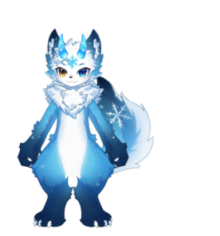
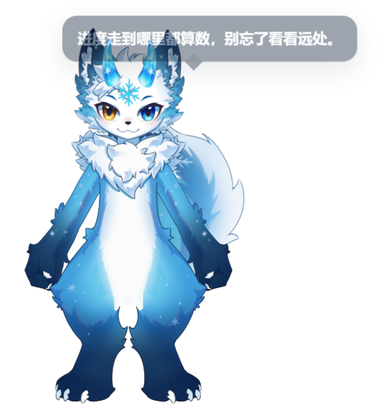
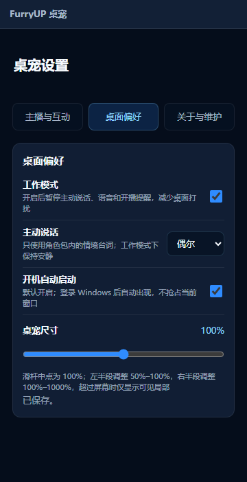

  

<h1 align="center">FurryUP 桌宠</h1>

<strong>没有自己的模型，也能拥有喜欢的主播桌宠。</strong>

FurryUP Desktop Pet · 官方客户端下载与更新记录

  <a href="https://frostynight.top/furryup/desktop-pet">官方网站</a> ·
  <a href="https://github.com/frostynight-furry/furryup-desktop-pet-releases/releases/tag/v0.3.0-beta.8">最新版本</a> ·
  <a href="#产品展示">产品展示</a> ·
  <a href="CHANGELOG.md">历次更新</a>

## 把喜欢的主播，带到自己的桌面

- **对粉丝：无需自备模型。** 通过主播分享的官方连接，确认后即可使用主播已发布并授权的角色模型，让喜欢的主播形象陪伴桌面日常。
- **对主播：非开播时间也能保持连接。** 在粉丝自愿开启的桌宠中持续陪伴，并在粉丝授权后远程触发表情、发送文字和开播提醒。
- **主播开播，桌宠来提醒。** 主播通过 FurryUP Studio 发送开播通知后，已连接并开启提醒的粉丝可在桌面看到提示。
- **随机语句，让陪伴多一点日常。** 对于提供了情境台词的角色包，桌宠会随机选取适合当前情境的语句，尽量减少重复；主动说话频率可以调整。
- **陪伴方式由粉丝决定。** 互动权限可以分项关闭，桌宠也可以随时隐藏。

## 下载客户端

当前版本：**0.3.0-beta.8** · Beta 测试版

| 适用系统 | 官方安装包 |
| --- | --- |
| **Windows 10 / Windows 11** 64 位（x64） | **[下载 EXE · 105.5 MiB](https://github.com/frostynight-furry/furryup-desktop-pet-releases/releases/download/v0.3.0-beta.8/FurryUP-Desktop-Pet-Setup-0.3.0-beta.8-x64.exe)** |
| **Windows 7 SP1 兼容版** 32 位（x86） | **[下载 MSI · 77.1 MiB](https://github.com/frostynight-furry/furryup-desktop-pet-releases/releases/download/v0.3.0-beta.8/FurryUP-Desktop-Pet-Legacy-Win7-Installer-0.3.0-beta.8-ia32.msi)** |

[查看本版完整说明](https://github.com/frostynight-furry/furryup-desktop-pet-releases/releases/tag/v0.3.0-beta.8) · [下载 SHA-256 校验文件](https://github.com/frostynight-furry/furryup-desktop-pet-releases/releases/download/v0.3.0-beta.8/SHA256SUMS-0.3.0-beta.8.txt)

- 本仓库镜像官网已公开发布的原始安装包。两个安装包均未签名，Windows 可能显示未知发布者提示；安装前请核对来源与校验值。
- Windows 10 / 11 版支持应用内更新或手动安装。Win7 兼容版独立安装、手动更新，尚未完成真实 Win7 安装验收。
- 首次启动不内置主播模型，确认主播连接后才下载已授权的模型内容。

下载校验与 Win7 兼容说明

在 PowerShell 中运行 `Get-FileHash -Algorithm SHA256 <安装包路径>`，与校验文件中的对应记录比较。

Win7 兼容版使用 Electron 22.3.27，不连接 Windows 10 / 11 x64 自动更新源；已完成包体检查与隔离运行验证，真实 Win7 环境的兼容性仍待验收。

## 产品展示

### 桌宠运行效果

  

角色直接显示在透明桌宠窗口中。图中的夜霜角色仅用于展示；安装包不内置主播模型，使用时通过主播连接下载已授权内容。

### 主播开播提醒

主播通过 FurryUP Studio 发送开播通知时，桌宠会以气泡提示已连接并授权接收提醒的粉丝。轻提醒不会自动打开直播间，是否前往由粉丝决定。

示例文案：

> 开播啦：今晚的直播开始了，欢迎来坐坐。

在“主播与互动 → 分项互动权限 → 开播提醒”中单独开启或关闭；工作模式下自动静默。

### 随机语句与日常陪伴

  

不直播的时候，桌宠也能偶尔说句话。对于提供了情境台词的角色包，桌宠会根据时段和互动情境随机选择语句，并尽量减少重复；具体内容由角色包提供。

在“桌面偏好 → 主动说话”中选择 **关闭、很少、偶尔或活跃**。开启工作模式后暂停主动说话。上图为随机台词的运行截图，示例角色不随安装包内置。

### 桌面偏好

  

按自己的节奏调整工作模式、主动说话频率、开机启动与桌宠尺寸。以上为实际界面预览，不同版本的布局细节可能有所调整。

### 三款应用图标

  
  
  

明快勾线 · 柔和插画 · 立体手办

在“桌面偏好 → 图标样式”中选择自己喜欢的风格，默认使用立体手办款。

## 最近更新

### 0.3.0-beta.8 · 模型列表更准确

- 主播撤下的模型会在刷新成功后从可选列表中移除；已下载的模型继续保留。
- 当前模型被撤下时显示状态提示，不强制切换；网络或校验失败时保留原列表。

### 0.3.0-beta.7 · 拖动和缩放更自然

- 桌宠在屏幕边缘拖动时不再被强制拉回；系统改变窗口大小时，模型不再意外缩放。
- 改善模型列表的容错，并提供独立的 Win7 兼容版。

**更多演进：** 从点击表情、超大尺寸和拖动稳定性，到粉丝连接引导、同一主播多模型选择与模型名称同步。

[查看 24 个历史版本的更新重点 →](CHANGELOG.md)

## 关于本仓库

本仓库用于公开分发客户端、产品图标、界面展示图和面向用户的更新说明，**应用源码保持私有**。GitHub 自动生成的 **Source code** 压缩包仅包含对应标签下的公开仓库文件，不含应用源码；安装客户端请使用上面的 EXE 或 MSI。

应用更新继续使用官网更新服务，GitHub 下载不会更改现有客户端的更新源。图标与品牌素材仅用于产品展示，不代表开放源码或另行授予素材使用许可。

发行主体：苏州工业园区夜霜文化创意工作室（个体工商户）  
客服邮箱：[yeshuang@frostynight.cn](mailto:yeshuang@frostynight.cn) · [官网隐私说明](https://frostynight.top/furryup/desktop-pet#privacy)
